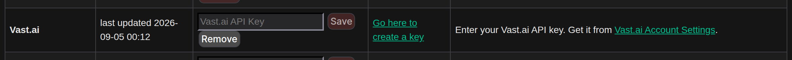
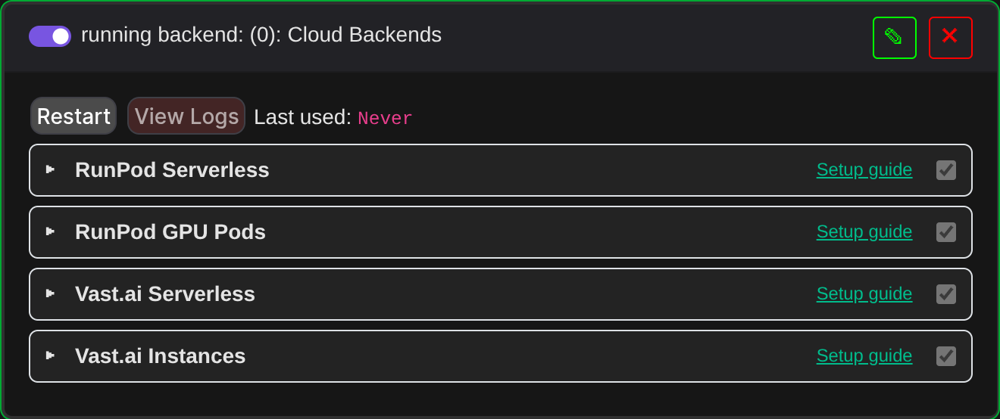
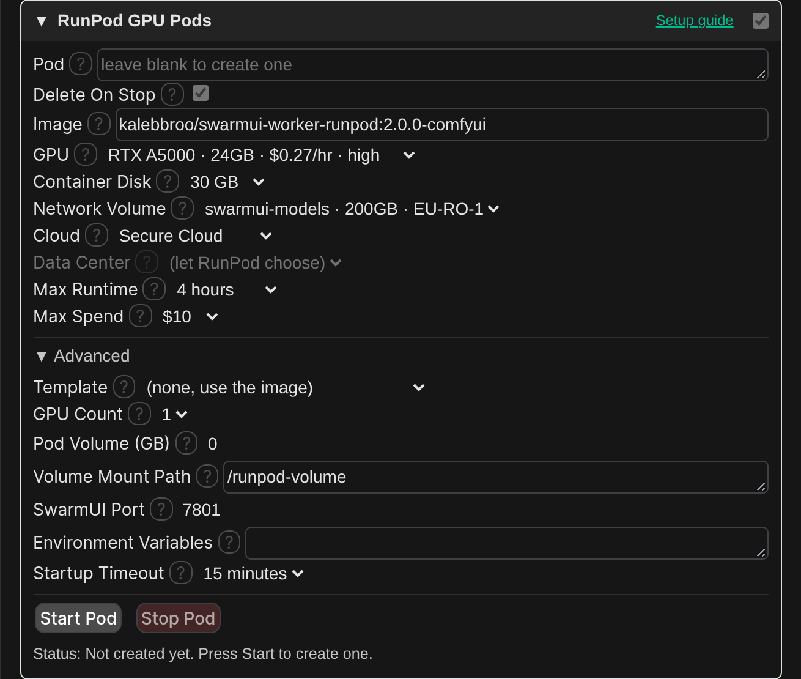

# SwarmUI Cloud Backends

Run your [SwarmUI](https://github.com/mcmonkeyprojects/SwarmUI) generations on cloud GPUs from RunPod and Vast.ai. Add one backend, generate as usual, and SwarmUI starts a cloud GPU when it needs one, adds more when you are busy, and shuts them down when you stop. You pay only while a GPU is working for you.

By Hartsy. MIT licensed.

## Providers

| Provider | What it is | Billing | Best for |
|---|---|---|---|
| **RunPod Serverless** | Workers that start on demand and shut down when idle. Scales out automatically. | Per second while a worker runs | Most people. Bursty or occasional use, models on a network volume. |
| **Vast.ai Serverless** | The same on Vast.ai's marketplace. The model is baked into your worker image. | Per second while a worker runs | Cheaper GPUs, when you are happy to build an image with your model in it. |
| **RunPod GPU Pods** | A whole GPU machine you start and stop from the card. | Per hour while running | Long sessions, or when you want the machine to stay warm. |
| **Vast.ai Instances** | The same on Vast.ai. | Per hour while running | Long sessions at marketplace prices. |

## Requirements

- SwarmUI (current release).
- An account with RunPod and/or Vast.ai, with credit.
- For serverless: an endpoint running the Hartsy worker image. The [setup guides](#quick-start) walk you through it.
  - RunPod: [`kalebbroo/swarmui-worker-runpod`](https://github.com/HartsyAI/RunPod-Worker-SwarmUI)
  - Vast.ai: an image built from [`kalebbroo/swarmui-worker-vast`](https://github.com/HartsyAI/Vast-Worker-SwarmUI)

## Installation

In SwarmUI, open **Server ▸ Extensions**, find **Cloud Backends**, and install it. SwarmUI restarts to load it.

To install by hand instead, clone this repository into `SwarmUI/src/Extensions/` and restart SwarmUI.

## Quick start

1. **Set up a provider.** Follow the step-by-step guide for the one you want. Each guide starts from a brand new account and ends with your first generation:

   | Guide | What you set up |
   |---|---|
   | [RunPod Serverless](docs/setup/runpod-serverless.md) | Account, API key, a network volume with your models, and a serverless endpoint. |
   | [RunPod GPU Pods](docs/setup/runpod-pods.md) | Account, API key, and a network volume. The card creates and starts the pod for you. |
   | [Vast.ai Serverless](docs/setup/vastai-serverless.md) | Account, API key, a worker image with your model in it, and a serverless endpoint. |
   | [Vast.ai Instances](docs/setup/vastai-instances.md) | Account and API key. The card rents and starts the instance for you. |

2. **Save your API key in SwarmUI.** Open **User ▸ User Info** and scroll to **API Keys**. Paste your RunPod and/or Vast.ai key into its row and press **Save**. Keys are per user: each user's cloud usage runs on, and is billed to, their own key.

   

   

   

3. **Add the card.** Open **Server ▸ Backends**, turn on **Show Advanced**, and press **Cloud Backends**.

   

4. **Fill in a section.** The card has one collapsible section per provider, each with a **Setup guide** link in its header. Turn on the ones you set up, fill them in as the guide says, and press **Save** at the top of the card. To change settings later, press **✎** on the card, edit, and press **Save** again.

   

   For example, the RunPod Serverless section, with its endpoint, Max Workers and Idle Shutdown settings, and its **Discover models**, **Validate** and **Refresh** buttons:

   

5. **Generate.** That's it.

Saving the card never starts or bills anything by itself. Serverless workers start only when a generation needs one; pods and instances start only when you press **Start**.

## How generation is routed

- **Local first.** If you have a local GPU backend that is free and has the model, it takes the generation. The cloud is used when your local backends are busy, or do not have the model.
- **A worker starts when needed.** The first cloud generation starts a worker (a cold start takes from under a minute with a warm worker to a few minutes from scratch). Later generations go straight to the running worker.
- **More workers under load.** If every running worker is busy and another generation arrives, another worker starts, up to **Max Workers**. If a busy worker frees up first, it takes the generation instead.
- **Workers shut down when idle.** After **Idle Shutdown** with no generation, a worker shuts down and stops billing. The next generation starts one again.

## Models

SwarmUI only offers models it knows about. There are two ways a cloud endpoint's models become known:

- **You have the model locally** (for example, the same files as on your RunPod volume). Pick it and generate; the first cloud generation also teaches SwarmUI every other model the endpoint has.
- **You don't.** Press **Discover models** in the serverless section once. It starts a worker (billed until it goes idle), reads its model list, and adds those models to your model list.

Either way the list is remembered per user and endpoint, across restarts. Use the `CloudClearModelCache` API route if you change what is on the endpoint.

## Provider settings

Every setting on the card has a **?** next to it that explains it. Each section works the same way:

- **Dropdowns come from your account.** Once your API key is saved, the Endpoint, Pod, Instance, GPU, Template, Network Volume and Data Center fields list what your account has, with prices. Without a key they stay plain text boxes.
- **Advanced holds the rest.** Settings only a custom setup needs sit under a collapsed **Advanced** group at the bottom of each section: a template, extra disk, the SwarmUI port, environment variables, and the startup timeout.
- **Delete On Stop** (pods and instances) is on by default. Stop then deletes a machine the card created, so nothing keeps billing afterwards. A pod or instance you picked yourself is only ever paused.
- **Failsafes** stop a pod or instance you forgot about. Max Runtime and Max Spend default to 4 hours and $10; **Off** turns either one off.

The setup guides walk through the settings that matter, in order:

- [RunPod Serverless](docs/setup/runpod-serverless.md): the endpoint, Max Workers and Idle Shutdown.
- [RunPod GPU Pods](docs/setup/runpod-pods.md): the image, GPU, network volume, Delete On Stop, the failsafes, and the Start and Stop buttons.
- [Vast.ai Serverless](docs/setup/vastai-serverless.md): the worker image, template, endpoint (Min Load 0, an inactivity timeout) and workergroup.
- [Vast.ai Instances](docs/setup/vastai-instances.md): the image, GPU, disk, network volume, the failsafes, and the Start and Stop buttons.

**Already running the version 1 RunPod image (`kalebbroo/swarmui-runpod`)?** It keeps working, in single-worker compatibility mode: one worker at a time, kept alive with keepalive jobs as before, and without an access token on the worker. Move the endpoint to `kalebbroo/swarmui-worker-runpod` when you want scaling and a secured worker; your network volume works with both.

## Keeping costs under control

- Serverless workers shut down after **Idle Shutdown**; nothing keeps one running unless you are generating.
- If SwarmUI stops unexpectedly, RunPod workers still shut themselves down when idle, and Vast.ai sessions expire on their own.
- The card shows a warning when a pod or instance created by Cloud Backends (under any name) is running but not attached to any card, for example after SwarmUI stopped uncleanly. Stop it from there.
- The **Workers** list in each serverless section shows every running worker, with a **Stop** button.
- **Validate** catches endpoint settings that would keep workers running or billing (Vast.ai Min Load, missing inactivity timeout, execution timeouts).

## Security

- Every worker, pod and instance only accepts requests carrying its access token. Serverless workers get a new token for each lease, which stops working the moment the worker is released; pods and instances get a per-user token the card manages.
- Vast.ai connections use TLS verified against Vast.ai's root certificate.
- Your provider API keys, and pod and instance tokens, are stored by SwarmUI in `Data/Users.ldb`. Protect that directory.
- Each user's cloud backends run on their own API key and only accept their own generations.

## Permissions

| Permission | Allows |
|---|---|
| Use RunPod Serverless | Generating on RunPod Serverless workers. |
| Use RunPod GPU Pods | Starting, stopping and generating on RunPod pods. |
| Use Vast.ai | Generating on Vast.ai Serverless workers. |
| Use Vast.ai Instances | Starting, stopping and generating on Vast.ai instances. |
| Cloud Backends Status/Refresh | Viewing workers and status, discovering models, validating, and stopping workers and orphans. |

All default to power users. Adding the Cloud Backends card itself needs SwarmUI's normal backend permissions.

## API

Everything the card does is available through SwarmUI's API. See [docs/APIRoutes/CloudBackendsWebAPI.md](docs/APIRoutes/CloudBackendsWebAPI.md) for every route, its parameters and its responses.

## Limitations

- **Endpoint settings are shared by all users of one card; API keys are per user.** A RunPod endpoint belongs to one account, so only that account's user can use a RunPod Serverless section. For Vast.ai, every user needs their own endpoint with the same name. On a multi-user server, give each user their own card, or use pods and instances.
- **The model list is shared across users** of the same server (SwarmUI's model list has no per-user view). Generation itself is per user.
- **Editing the card restarts it**, which releases every user's running workers. They start again on next use.
- **Stopping a generation stops every generation on that worker**, because they share one session on the worker.

## Troubleshooting

| Message | What to do |
|---|---|
| `RunPod rejected the API key` / `Vast.ai rejected the API key` | Check the key in User Settings ▸ API Keys. |
| `RunPod endpoint '...' was not found` | Check the Endpoint ID, and that the endpoint belongs to your account. |
| `The RunPod worker image is too old` | The endpoint runs an image that is neither the version 1 nor the version 2 worker. Point it at `kalebbroo/swarmui-worker-runpod` 2.0.0 or later. |
| `...version 1 worker image, which supports one worker at a time` | The version 1 image can hold only one worker. Move the endpoint to `kalebbroo/swarmui-worker-runpod` to run more. |
| `No RunPod worker picked up the lease` / `No Vast.ai worker became available` | The provider had no GPU for you in time. Check the endpoint's max workers and GPU choices, or raise Startup Timeout. |
| `worker ... is running SwarmUI with no backend configured` | The worker image is not a Hartsy worker image, or is broken. |
| `worker ... refused its lease token` | The worker was released (idle, or stopped). The next generation starts a new one. |
| A model is missing from the list | Press **Discover models**, or clear the remembered list with `CloudClearModelCache` if the endpoint's models changed. |
| Workers keep running after you stop | Press **Validate**; on Vast.ai, check Min Load is 0 and an Inactivity Timeout is set. |

For more detail, run SwarmUI with `--loglevel debug` and look for lines tagged `[RunPodServerless]`, `[VastAI]` or `[CloudBackends]`.

## For developers

How it works inside: [docs/ARCHITECTURE.md](docs/ARCHITECTURE.md). Tests: `dotnet test src/Extensions/SwarmUI-CloudBackends/Tests` after building SwarmUI.

## License

MIT, see [LICENSE](LICENSE).
