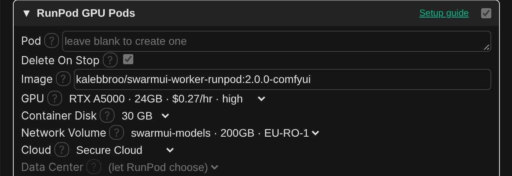
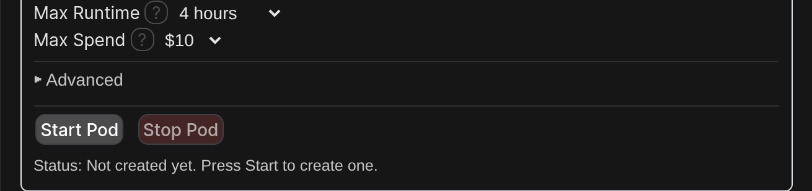

# RunPod GPU Pods setup

This guide takes you from no RunPod account to generating in SwarmUI on a RunPod GPU pod: a whole GPU machine that you start and stop from SwarmUI. Follow it top to bottom.

**Pods or serverless?** A pod runs, and bills by the hour, from when you press **Start Pod** until you press **Stop Pod**. It never has a cold start in between, so it suits long sessions. If you generate in bursts, [RunPod Serverless](runpod-serverless.md) is usually cheaper, because it only bills while generating.

> Tip: every screenshot is full resolution. Click one to open it full size and zoom in.

## What you need

- SwarmUI with the Cloud Backends extension installed. See [Installation](../../README.md#installation).
- A card to pay RunPod with. RunPod is prepaid: you add credit, and usage is taken from it.

## Step 1: Create a RunPod account and add credit

1. Go to [runpod.io](https://www.runpod.io/) and sign up.
2. In the console, open **Billing** in the left menu, choose an amount and press **Pay with card**.

## Step 2: Create a RunPod API key

1. In the left menu, open **Credentials** (the **API Keys** tab) and press **Create API Key**.

   

2. Name it (for example `SwarmUI`), leave the permission on **All**, and press **Create**.

   

3. **Copy the key now.** RunPod shows it only once.

## Step 3: Put the key into SwarmUI

In SwarmUI, open **User ▸ User Info ▸ API Keys**, paste the key into the **RunPod** row, and press **Save**.

## Step 4: Create a network volume and put your models on it

A pod's own disk is wiped when the pod is deleted, so keep your models on a **network volume**. It survives the pod, and you can attach it to the next one, or to a serverless endpoint later.

Follow [RunPod Serverless, Step 4 and Step 5](runpod-serverless.md#step-4-create-a-network-volume-for-your-models): create the volume, then fill its `Models` folder. The pod and serverless workers read the same layout, so one volume serves both.

When you pick the volume's data center, check that it has the GPU you want: pods with a volume can only run in the volume's data center.

## Step 5: Add the Cloud Backends card in SwarmUI

1. Open **Server ▸ Backends**, turn on **Show Advanced**, and press **Cloud Backends**. (If you already have a Cloud Backends card, press **✎** on it instead.)

   

2. Turn on the switch in the **RunPod GPU Pods** header and open the section. With your API key saved, the pod, GPU, network volume, data center and template boxes turn into dropdowns filled from your account, with live prices.

   

3. Set at least these:

   | Setting | Value |
   |---|---|
   | Pod | Leave on **(create one for me)**. The card then creates a pod for you, and finds it again next time. |
   | Delete On Stop | Leave on. Stop Pod then deletes the pod, and the next Start makes a fresh one; your models stay on the network volume. Off only pauses it, but RunPod clears a paused pod's disk anyway, and a paused pod can come back without a GPU. |
   | Image | Leave the default (the Hartsy RunPod worker with ComfyUI), or pick the HartsyInference version from the suggestions. |
   | GPU | The GPU to rent. **(cheapest available)** takes the cheapest one that's free. 16 GB of VRAM or more; 24 GB for large models like Flux. |
   | Container Disk | `30 GB` or more for the ComfyUI image (`50 GB` is the default). |
   | Network Volume | Your volume from Step 4. The pod is created in its data center, so **Data Center** greys out. |
   | Cloud | **Secure Cloud** is more reliable; **Community Cloud** is cheaper. |

4. Check the failsafes, so a pod you forgot about stops by itself:

   | Setting | Value |
   |---|---|
   | Max Runtime | Stop the pod after it has run this long. `4 hours` by default; **Off** turns it off. |
   | Max Spend | Stop the pod once it has cost about this much. `$10` by default; **Off** turns it off. |

   **Advanced** holds settings only a custom setup needs: a RunPod template, GPU count, a pod volume, the volume mount path, the SwarmUI port, extra environment variables, and the startup timeout.

5. Press **Save** at the top of the card. Saving never starts a pod.

## Step 6: Start the pod

Press **Start Pod** at the bottom of the section. SwarmUI shows the price per hour and asks you to confirm. It then creates the pod, waits for it to boot (a few minutes the first time), and connects to it. The status line under the buttons shows progress.

The card gives the pod a private access token, so nobody else can use your pod even though RunPod gives it a public address.

## Step 7: Generate

Pick a model and generate as usual. SwarmUI only lets you pick models it knows about, so if a model on your volume doesn't show up in your model list, see [Models](../../README.md#models).

Your local GPU is still used first when it's free and has the model; the pod takes generations when the local one is busy or doesn't have the model.

## Step 8: Stop the pod when you're done

Press **Stop Pod**. A pod bills by the hour for as long as it runs, whether or not you're generating. If SwarmUI stops unexpectedly while a pod runs, the card shows a warning the next time you open it, with a button to stop the pod.

You can also see and stop your pods in the RunPod console under **Pods**.

## Using a pod you made yourself

Pick that pod under **Pod**. The pod must run the Hartsy RunPod worker image (`kalebbroo/swarmui-worker-runpod`), expose port `7801` as HTTP, and have `SWARMUI_WORKER_TOKEN` set to a random value of at least 32 characters. Put the same value in **Worker Token**, which shows once a pod is picked. Turn off **Delete On Stop** unless you want Stop Pod to delete your pod. Letting the card create the pod is simpler, because it handles all of that.

## What it costs

| What | When you pay |
|---|---|
| The pod | Per hour while it runs. The price is shown before you start it. |
| The pod's disk | A little per hour while the pod exists, even stopped. Terminating the pod ends it. |
| Network volume | Every month, by its size ($0.07 per GB). |

## If something goes wrong

| Problem | What to do |
|---|---|
| The dropdowns stay as plain text boxes | Save your RunPod API key (Step 3), then reopen the section. |
| Start fails because no GPU is available | The GPU you chose is out of stock in that data center. Pick another GPU type, or **(cheapest available)**. |
| The pod starts but never connects | Check the status line and the pod's logs in the RunPod console. Raise **Startup Timeout** (under **Advanced**) if it's still downloading the image. |
| Models are missing | Check they're under `Models/...` on the network volume, and that the volume is attached (**Network Volume**). |

More fixes are in the [README's troubleshooting section](../../README.md#troubleshooting).
