# RunPod Serverless setup

This guide takes you from no RunPod account to generating images in SwarmUI on RunPod's serverless GPUs. Follow it top to bottom. It takes about 20 minutes, plus the time to upload your models.

**How it works:** your models live on a RunPod **network volume**. A RunPod **serverless endpoint** runs the Hartsy SwarmUI worker. When you generate in SwarmUI, Cloud Backends starts a worker on that endpoint, sends the generation to it, and lets the worker shut down once you stop generating. You pay per second only while a worker runs, plus a small monthly fee for the volume.

> Tip: every screenshot is full resolution. Click one to open it full size and zoom in.

## What you need

- SwarmUI with the Cloud Backends extension installed. See [Installation](../../README.md#installation).
- A card to pay RunPod with. RunPod is prepaid: you add credit, and usage is taken from it.
- The model files you want to use (for example a `.safetensors` checkpoint).

## Step 1: Create a RunPod account and add credit

1. Go to [runpod.io](https://www.runpod.io/) and sign up.
2. In the console, open **Billing** in the left menu.
3. Choose an amount (or **Other** for a smaller one) and press **Pay with card**. $10 to $25 is plenty to start.

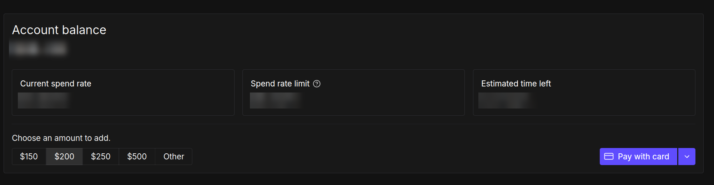

You can also turn on **Auto-Pay** on the same page, so your balance never runs dry in the middle of a job.

## Step 2: Create a RunPod API key

SwarmUI uses this key to start and stop workers on your account.

1. In the left menu, open **Credentials**. You land on the **API Keys** tab.
2. Press **Create API Key**.

   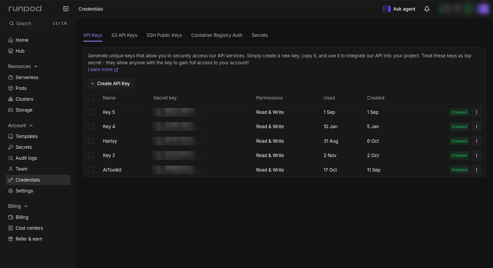

3. Give it a name (for example `SwarmUI`), leave the permission on **All**, and press **Create**.

   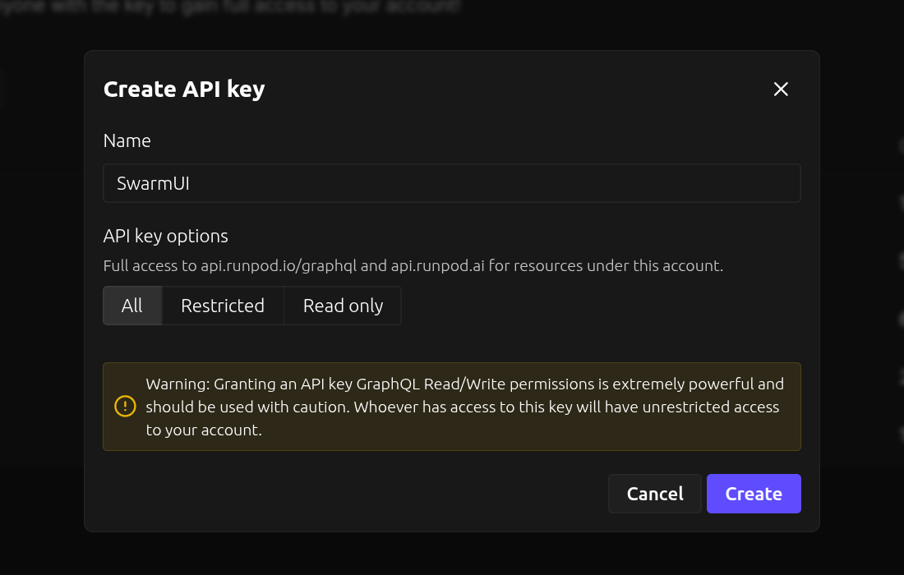

4. **Copy the key now.** RunPod shows it only once. Keep it somewhere safe: anyone who has it can spend your credit.

## Step 3: Put the key into SwarmUI

1. In SwarmUI, open the **User** tab, then **User Info**, and scroll to **API Keys**.

   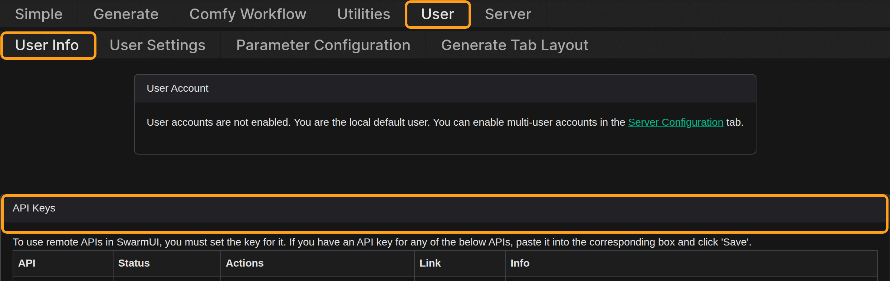

2. Find the **RunPod** row, paste the key into the box, and press **Save**. The status changes to "last updated" with today's date.

   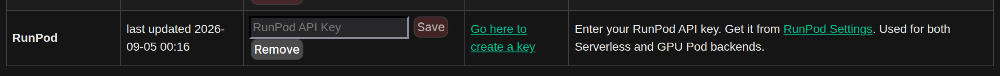

Keys are per user: on a server with user accounts, each user saves their own key and is billed on their own RunPod account.

## Step 4: Create a network volume for your models

The network volume is a disk in one RunPod data center. Workers mount it, so every worker sees the same models.

1. In the left menu, open **Storage** and press **New volume**.
2. Under **Storage type**, keep **Network volume** selected.

   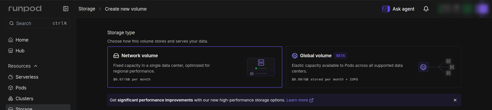

3. Pick a **data center**. When you click one, the table on the right shows how many GPUs of each type are free there. Pick one where 24 GB cards (RTX 4090, RTX 3090, RTX A5000, L4) show **High** or **Medium**, because your workers can only run in this data center. A data center with the **S3** badge also lets you upload files with S3 tools later.

   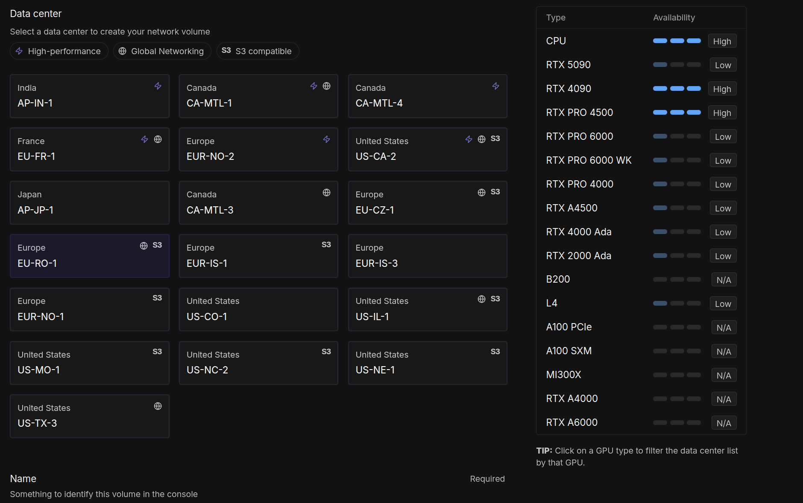

4. Give the volume a **name** (for example `SwarmUI-Models`) and a **size**. Add up the size of your models and leave room to grow: SDXL checkpoints are about 7 GB each, Flux models 12 to 24 GB. It costs $0.07 per GB per month, so 200 GB is $14 a month. You can make it bigger later, but never smaller.
5. Press **Create network volume**.

   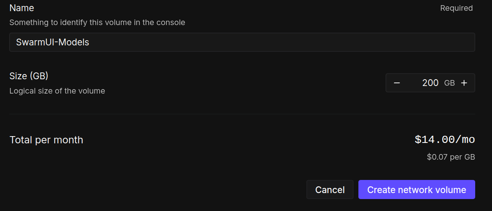

## Step 5: Put your models on the volume

The worker looks for a `Models` folder at the top of the volume, laid out like SwarmUI's own `Models` folder:

```
Models/
  Stable-Diffusion/   checkpoints (SDXL, Flux, and so on)
  Lora/               LoRAs
  VAE/                VAEs
  text_encoders/      text encoders (clip/ also works)
```

The easiest way to fill it is a short-lived pod that has the volume attached.

1. Open **Pods** in the left menu and press **Deploy**.
2. Keep the default **Runpod Pytorch** template, name the pod (for example `model-uploader`), and open **Region**. Choose **Network volume** and pick your volume.

   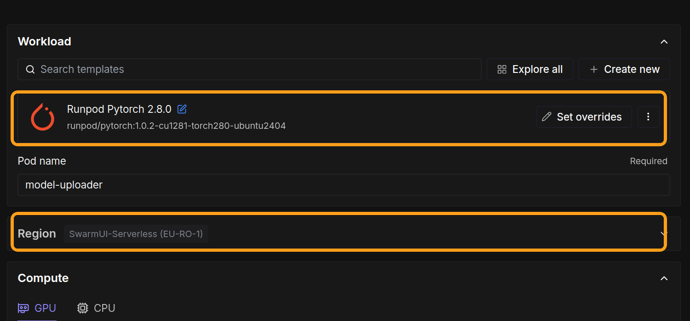

3. Pick the cheapest GPU on the list (an RTX 2000 Ada or similar is fine; this pod only copies files). Under **Storage** you'll see your volume mounted at `/workspace`. Press **Deploy Pod**.

   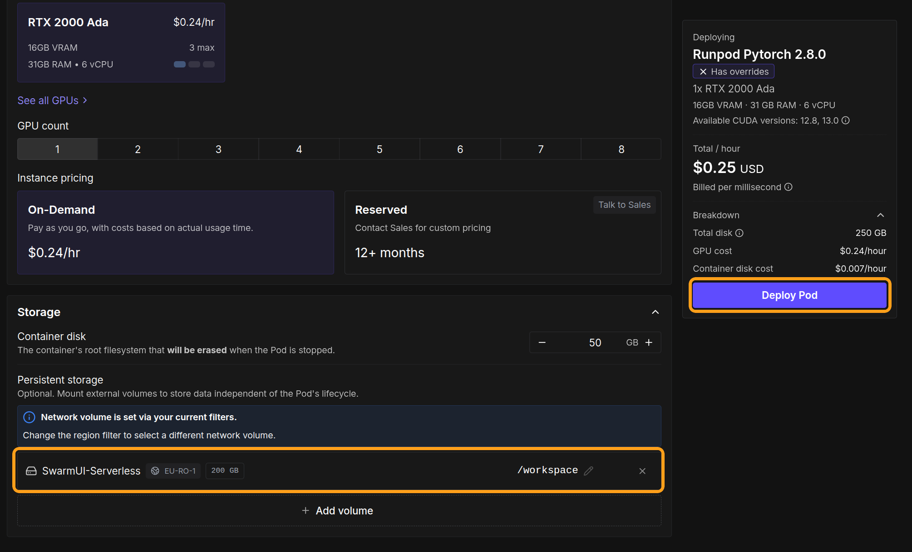

4. When the pod is running, press **Connect** on it and open **Jupyter Lab**. In Jupyter Lab, open a **Terminal**.
5. Create the folders and download your models into them. For example:

   ```bash
   mkdir -p /workspace/Models/Stable-Diffusion /workspace/Models/Lora /workspace/Models/VAE /workspace/Models/text_encoders
   cd /workspace/Models/Stable-Diffusion
   wget -O sd_xl_base_1.0.safetensors "https://huggingface.co/stabilityai/stable-diffusion-xl-base-1.0/resolve/main/sd_xl_base_1.0.safetensors"
   ```

   - **Hugging Face:** use the file's **download** link (the URL has `/resolve/` in it). For gated models, add `--header="Authorization: Bearer <your Hugging Face token>"` to the `wget` command.
   - **Civitai:** copy the model's download link and add `?token=<your Civitai API key>` to the end.
   - **Files on your computer:** drag them into Jupyter Lab's file browser, into the right folder. This is fine for small files like LoRAs; for big checkpoints, downloading on the pod is much faster.

6. When you're done, go back to **Pods**, press **Stop**, then **Terminate** the pod. Your files stay on the network volume; only the pod is deleted. A pod bills by the hour while it runs, so don't leave it on.

**Using S3 instead:** if you chose a data center with the S3 badge, you can upload with any S3 tool (such as `aws s3 cp`) using an **S3 API key** from **Credentials ▸ S3 API Keys**. Upload to the `Models/...` paths in the volume's bucket. See RunPod's [S3 API guide](https://docs.runpod.io/storage/s3-api).

## Step 6: Create the serverless endpoint

1. Open **Serverless** in the left menu and press **New endpoint**.
2. Under **Custom code**, choose **Deploy from a Docker image**.

   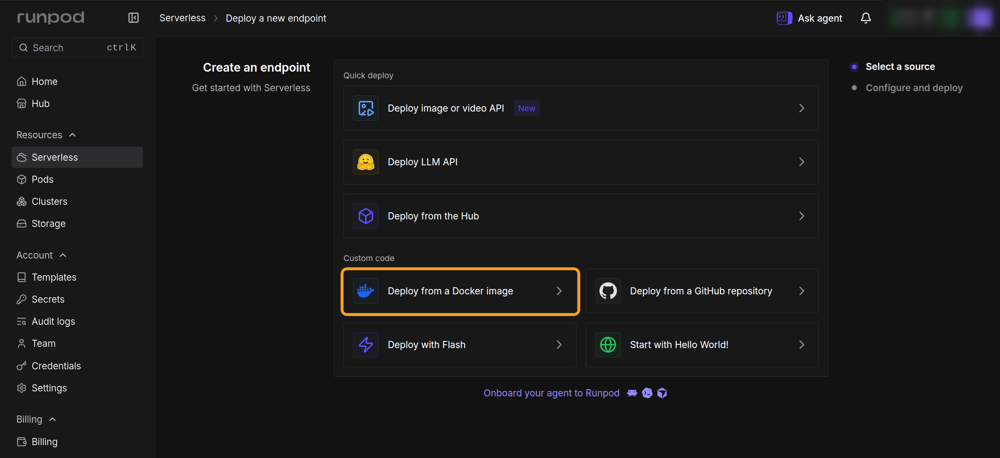

3. Fill in **Configure image**:

   | Setting | Value |
   |---|---|
   | Container image | `kalebbroo/swarmui-worker-runpod:2.0.0-comfyui` (or `2.0.0-hartsyinference` for Hartsy's own backend: smaller and faster to start, but it needs CUDA 13) |
   | Container configuration ▸ Container disk | `30` GB for ComfyUI, `15` GB for HartsyInference |
   | Container configuration ▸ Expose HTTP ports | `7801`. Without it, SwarmUI cannot reach the worker. |
   | Endpoint type | **Queue** (the default). Not Load balancer. |

   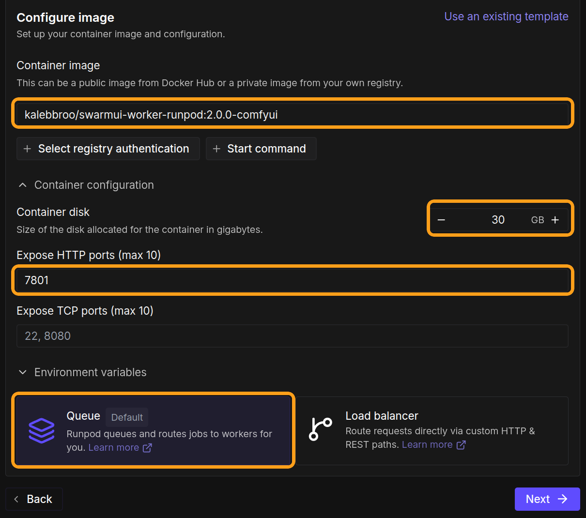

4. Press **Next**. Fill in **Configure endpoint**:

   | Setting | Value |
   |---|---|
   | Endpoint name | Anything, for example `swarmui-worker` |
   | GPU configuration | **24 GB** is a good default. Tick more than one size to give RunPod a fallback when your first choice is busy. 16 GB works for SD 1.5 and SDXL. |
   | Max workers | The most workers you ever want running at once. It must be at least the **Max Workers** you set on the SwarmUI card. `2` is a good start. |

   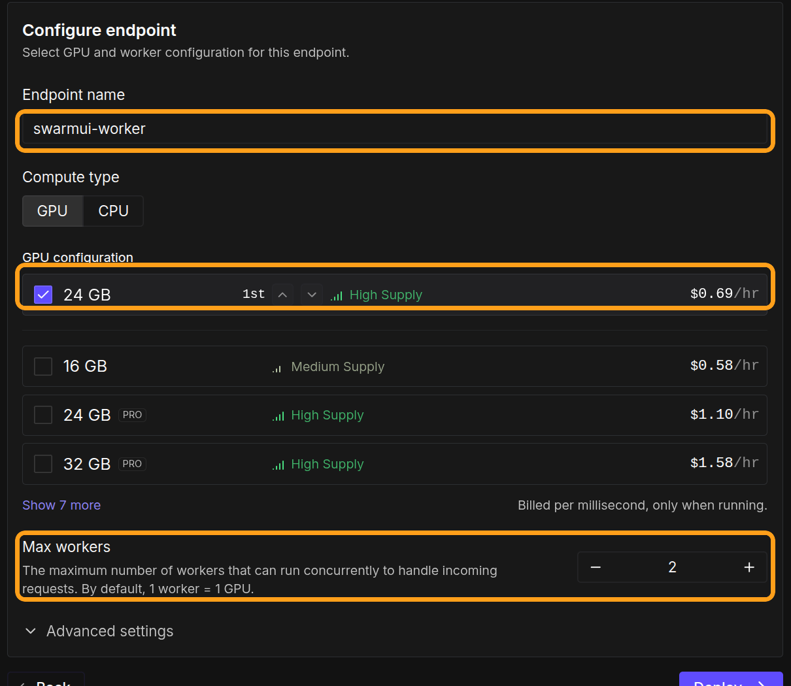

5. Open **Advanced settings**:

   | Setting | Value | Why |
   |---|---|---|
   | Active workers | `0` | Anything above 0 keeps workers running, and billing, all the time. |
   | Idle timeout | `5` sec (the default) | The worker already waits for its own idle time before it lets go. |
   | Enable FlashBoot | On | Faster cold starts, at no extra cost. |
   | Enable execution timeout | On, `4200` sec | Must be longer than **Max Lease Seconds** on the SwarmUI card (3600 by default). |

   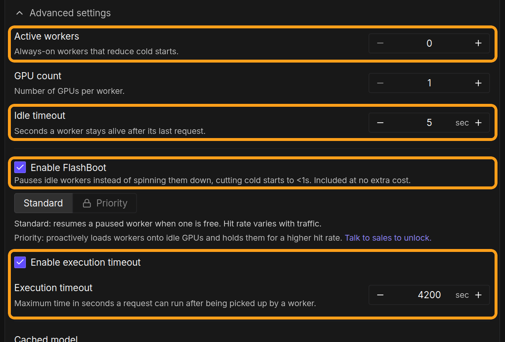

6. Further down in **Advanced settings**:

   | Setting | Value |
   |---|---|
   | Network volumes | Your volume from Step 4. The data center is then locked to the volume's. |
   | Allowed CUDA versions | `12.8` and newer for ComfyUI. `13.0` and newer for HartsyInference. Older drivers fail to start the worker. |

   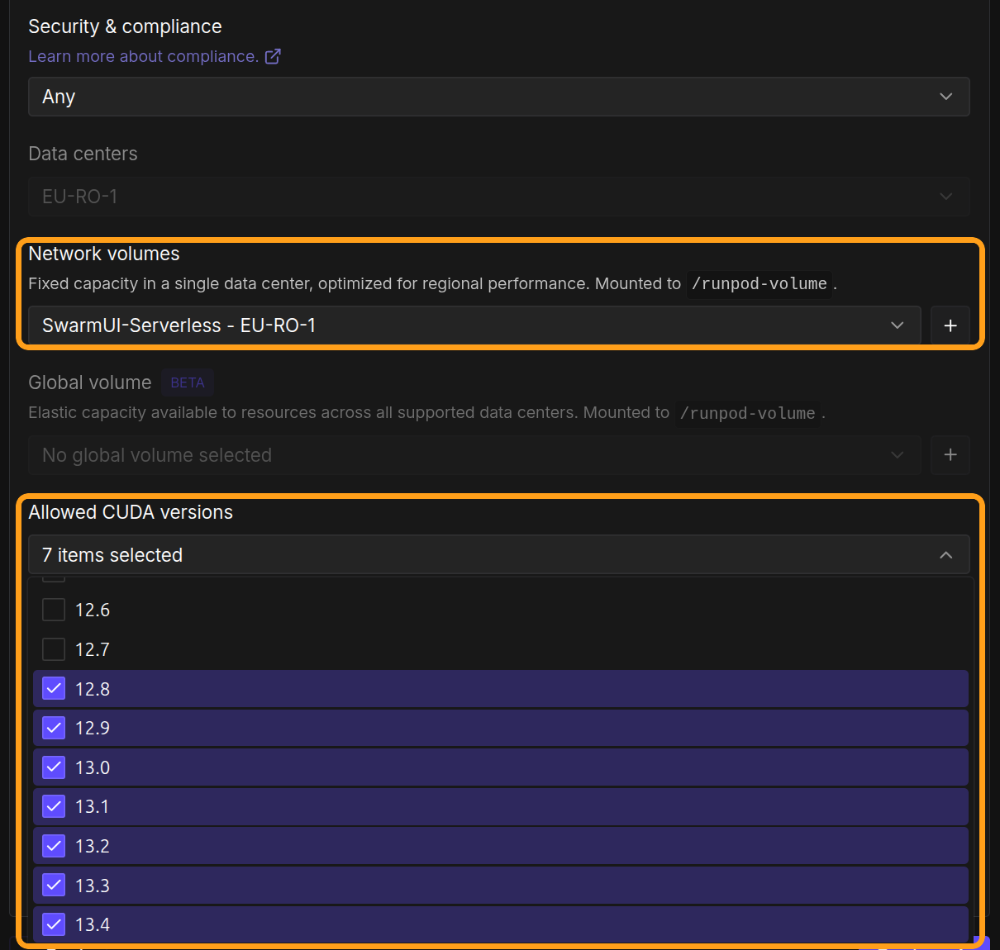

7. Press **Deploy**. Creating the endpoint costs nothing; with 0 active workers it bills only while a worker runs.

## Step 7: Copy the endpoint ID

Open the new endpoint. Its **Endpoint ID** is shown on the **Overview** tab (it's also the last part of the page's address). Copy it.

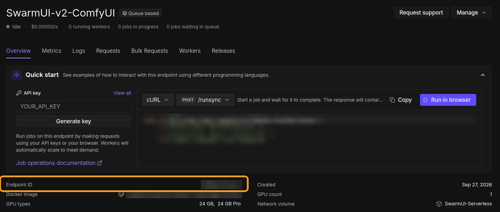

## Step 8: Add the Cloud Backends card in SwarmUI

1. In SwarmUI, open **Server ▸ Backends**. Turn on **Show Advanced**, then press **Cloud Backends**.

   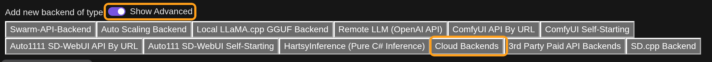

2. The new card opens ready to edit. Open the **RunPod Serverless** section and set:

   | Setting | Value |
   |---|---|
   | Enabled | On |
   | EndpointId | The endpoint ID from Step 7 |
   | MaxWorkers | How many workers SwarmUI may run at once. `1` means never more than one. At most the endpoint's Max workers. |
   | IdleSeconds | How long a worker waits with nothing to do before it shuts down. Lower costs less; higher avoids waiting for a cold start between bursts. `120` is a good default. |
   | MaxLeaseSeconds | Leave at `3600`. Must stay below the endpoint's execution timeout. |
   | StartupTimeoutSec | Leave at `800`. |

3. Press **Save** at the top of the card. To change settings later, press **✎** on the card, edit, and press **Save** again.

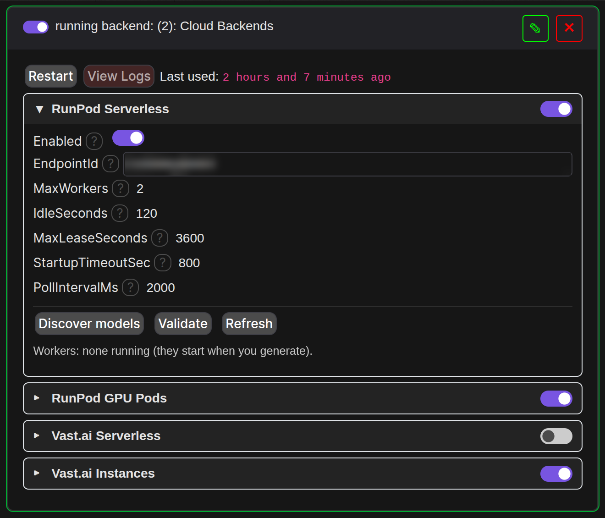

Saving never starts a worker or costs anything by itself.

## Step 9: Validate

Press **Validate** in the RunPod Serverless section. It reads your endpoint's settings from RunPod and checks them against the card: the image, the exposed HTTP port, the execution timeout, max workers, and (for HartsyInference) the allowed CUDA versions. Fix anything it lists. Validate is free; it never starts a worker.

## Step 10: Generate

SwarmUI only lets you pick models it knows about. Either:

- **You have the same model locally** (in your own SwarmUI `Models` folder): pick it and generate. Your local GPU is used first when it's free; the cloud takes over when it's busy or doesn't have the model.
- **You don't:** press **Discover models** once. It starts a worker (billed until it goes idle, usually a minute or two), reads the models on your volume, and adds them to your model list. The list is remembered after that.

Then generate as usual. What to expect:

- **The first generation waits for a worker to start.** That's from under a minute up to a few minutes, the first time an image is pulled onto a machine. Later generations go straight to the running worker.
- **The Workers line** in the section shows each running worker, with a **Stop** button.
- **After IdleSeconds with no generation, the worker shuts down** and billing stops. The next generation starts one again.
- **When you're busy, more workers start**, up to MaxWorkers.

## What it costs

| What | When you pay |
|---|---|
| Network volume | Every month, by its size ($0.07 per GB). Deleting files doesn't lower it; only a smaller volume does. |
| Serverless workers | Per second, only while a worker is running. The GPU price is shown next to each GPU size on the endpoint. |
| The upload pod | Per hour while it runs. Terminate it when you're done. |

Nothing bills while no worker is running, apart from the volume.

## If something goes wrong

| Problem | What to do |
|---|---|
| Validate says the API key was rejected | Check the key under **User ▸ User Info ▸ API Keys**, or create a new one. |
| Validate says the endpoint was not found | Check the Endpoint ID, and that the endpoint was created with the same RunPod account as the key. |
| "No RunPod worker picked up the lease" | RunPod had no free GPU of your sizes in your data center. Tick more GPU sizes on the endpoint, or try again later. |
| The worker starts but generation fails with a CUDA error | Set **Allowed CUDA versions** on the endpoint (Step 6). |
| A model is missing | Check it's under the right `Models/...` folder on the volume, then press **Discover models** again. |

More fixes are in the [README's troubleshooting section](../../README.md#troubleshooting).
