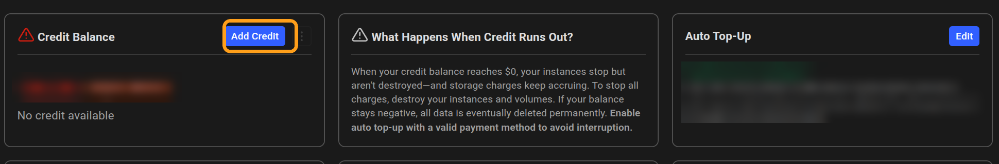
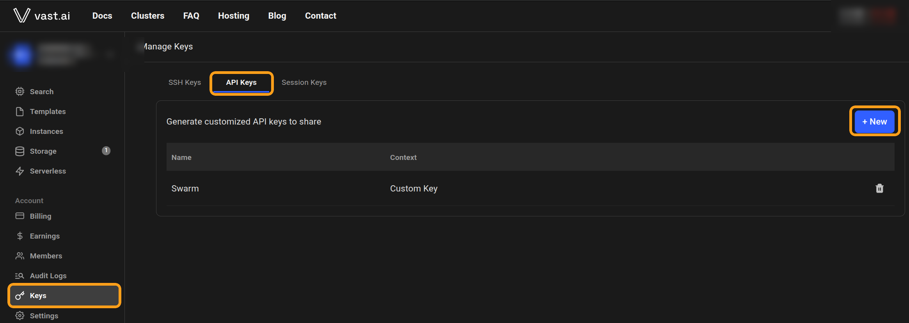
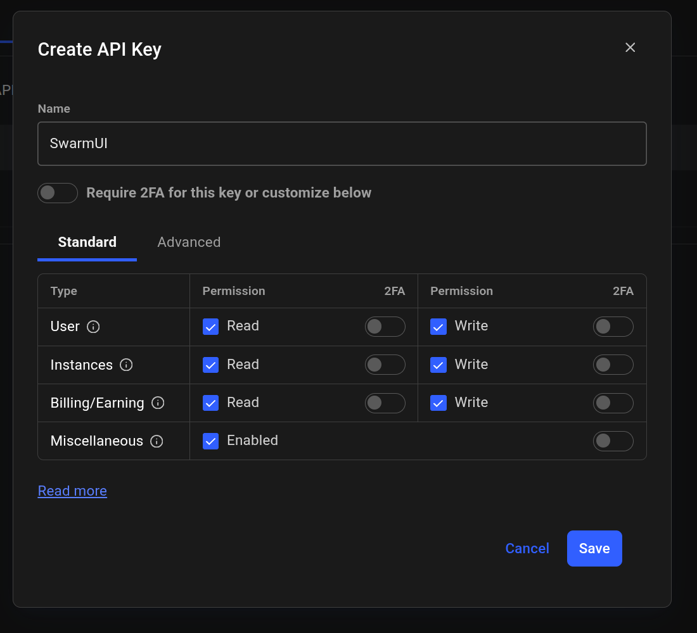
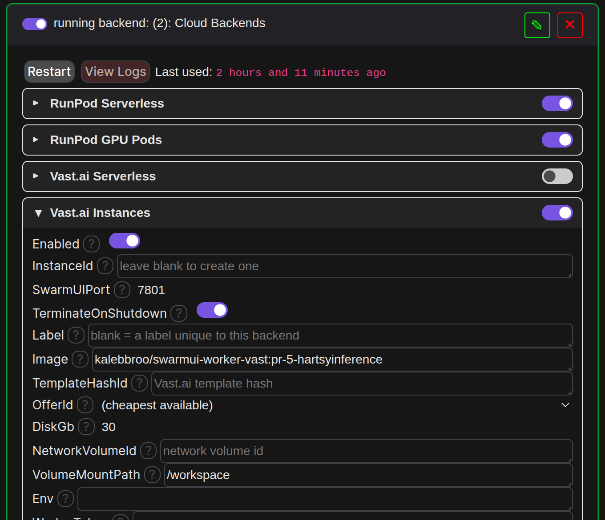
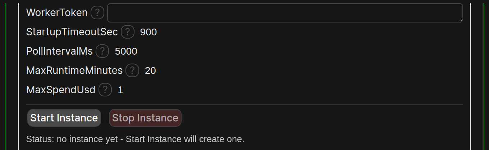

# Vast.ai Instances setup

This guide takes you from no Vast.ai account to generating in SwarmUI on a rented Vast.ai machine (an "instance"), which you start and stop from SwarmUI. Follow it top to bottom.

**Instances or serverless?** An instance runs, and bills by the hour, from when you press **Start Instance** until you press **Stop Instance**, so it suits long sessions. [Vast.ai Serverless](vastai-serverless.md) only bills while generating, but needs your model built into the image.

> Tip: every screenshot is full resolution. Click one to open it full size and zoom in.

## What you need

- SwarmUI with the Cloud Backends extension installed. See [Installation](../../README.md#installation).
- Some Vast.ai credit.

## Step 1: Create a Vast.ai account and add credit

1. Go to [cloud.vast.ai](https://cloud.vast.ai/) and sign up.
2. Open **Billing** in the left menu, press **Add Credit**, pick an amount and a payment method, and press **Add credit**.

## Step 2: Create a Vast.ai API key

1. Open **Keys** in the left menu, then the **API Keys** tab, and press **+ New**.

   

2. Name it (for example `SwarmUI`), keep the default permissions, and press **Save**. Copy the key that's shown.

   

## Step 3: Put the key into SwarmUI

In SwarmUI, open **User ▸ User Info ▸ API Keys**, paste the key into the **Vast.ai** row, and press **Save**.

## Step 4: Add the Cloud Backends card in SwarmUI

1. Open **Server ▸ Backends**, turn on **Show Advanced**, and press **Cloud Backends**. (If you already have a Cloud Backends card, press **✎** on it instead.)

   

2. Open the **Vast.ai Instances** section and turn on **Enabled**. With your API key saved, **OfferId** becomes a dropdown of machines you can rent right now, with prices.

   

3. Set at least these:

   | Setting | Value |
   |---|---|
   | InstanceId | Leave blank. The card then rents an instance for you, and finds it again next time. |
   | Image | Leave the default (the Hartsy Vast.ai worker, pinned to a release). |
   | OfferId | Leave on **(cheapest available)**, or pick a machine from the dropdown. |
   | DiskGb | Room for the image plus any models it downloads. `30` or more. |
   | TerminateOnShutdown | Off keeps the instance (stopped) when you stop it, so its disk and anything on it survive, but storage bills a little while stopped. On destroys it. |
   | NetworkVolumeId | Optional: a Vast.ai volume you already created, holding your models (in a `Models` folder). It's mounted at `/workspace`. |

4. Set the failsafes, so an instance you forgot about stops by itself:

   | Setting | Value |
   |---|---|
   | MaxRuntimeMinutes | Stop the instance after this many minutes running. `0` turns it off. |
   | MaxSpendUsd | Stop the instance once it has cost about this many dollars. `0` turns it off. |

5. Press **Save** at the top of the card. Saving never rents anything.

## Step 5: Start the instance

Press **Start Instance** at the bottom of the section. SwarmUI shows the price per hour and asks you to confirm, then rents the machine, waits for it to boot, and connects. The status line under the buttons shows progress.

Without an OfferId, the card rents the cheapest matching machine that has enough open ports. If a machine it rented never becomes reachable, the card destroys it and rents a different one (up to 3 tries).

The connection is encrypted and checked against Vast.ai's own certificate, and the card gives the instance a private access token, so nobody else can use it.

## Step 6: Generate

Pick a model and generate as usual. SwarmUI only lets you pick models it knows about, so if a model on the instance doesn't show up in your model list, see [Models](../../README.md#models).

Your local GPU is still used first when it's free and has the model; the instance takes generations when the local one is busy or doesn't have the model.

## Step 7: Stop the instance when you're done

Press **Stop Instance**. An instance bills by the hour for as long as it runs, whether or not you're generating. If SwarmUI stops unexpectedly while an instance runs, the card shows a warning the next time you open it, with a button to stop it.

You can also see and stop your instances on Vast.ai under **Instances**.

## Using an instance you made yourself

Set **InstanceId** to its ID. It must run the Hartsy Vast.ai worker image (`kalebbroo/swarmui-worker-vast`) in entrypoint mode, expose port `7801`, and have `SWARMUI_WORKER_TOKEN` set to a random value of at least 32 characters. Put the same value in **WorkerToken** on the card. Letting the card rent the instance is simpler, because it handles all of that.

## What it costs

| What | When you pay |
|---|---|
| The instance | Per hour while it runs, at the machine's price. Shown before you start it. |
| Its disk | A little while the instance exists, even stopped. Destroying it ends that. |
| Volumes | Monthly, for as long as the volume exists, even unused. Delete volumes you no longer need on the **Storage** page. |

## If something goes wrong

| Problem | What to do |
|---|---|
| OfferId stays a plain text box | Save your Vast.ai API key (Step 3), then reopen the section. |
| Start fails because the offer is gone | Someone else rented that machine. Pick another, or use **(cheapest available)**. |
| The instance starts but never connects | The card retries on another machine. If it keeps failing, raise **StartupTimeoutSec**, and check the instance's logs on Vast.ai. |

More fixes are in the [README's troubleshooting section](../../README.md#troubleshooting).
