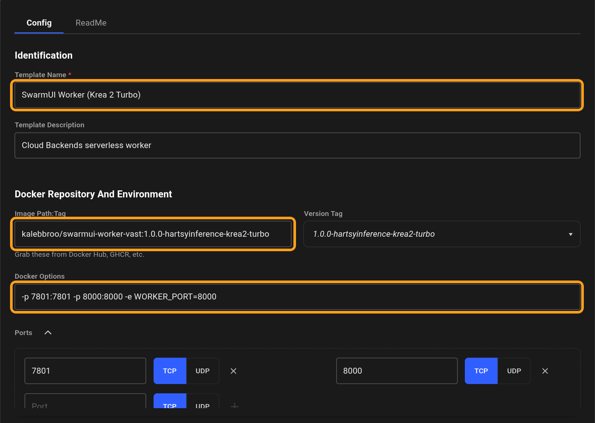
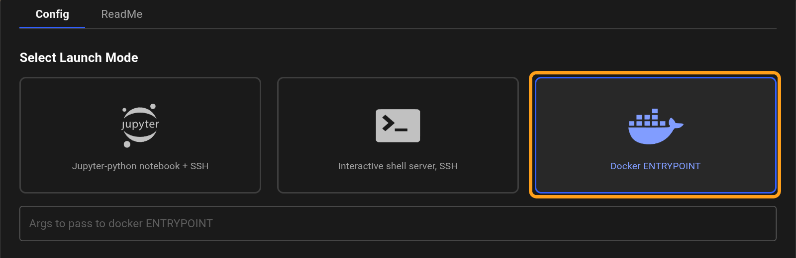
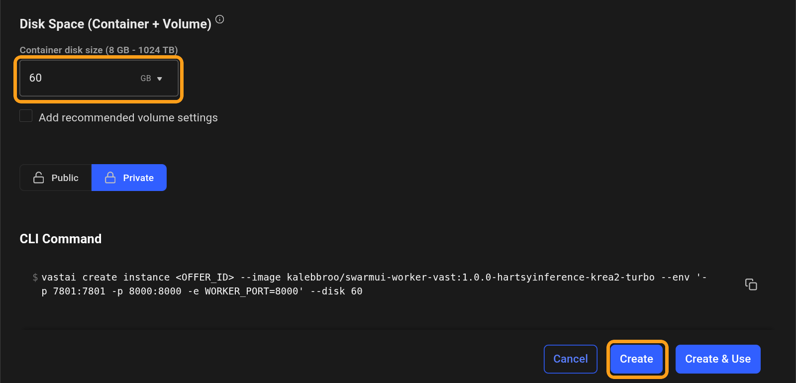
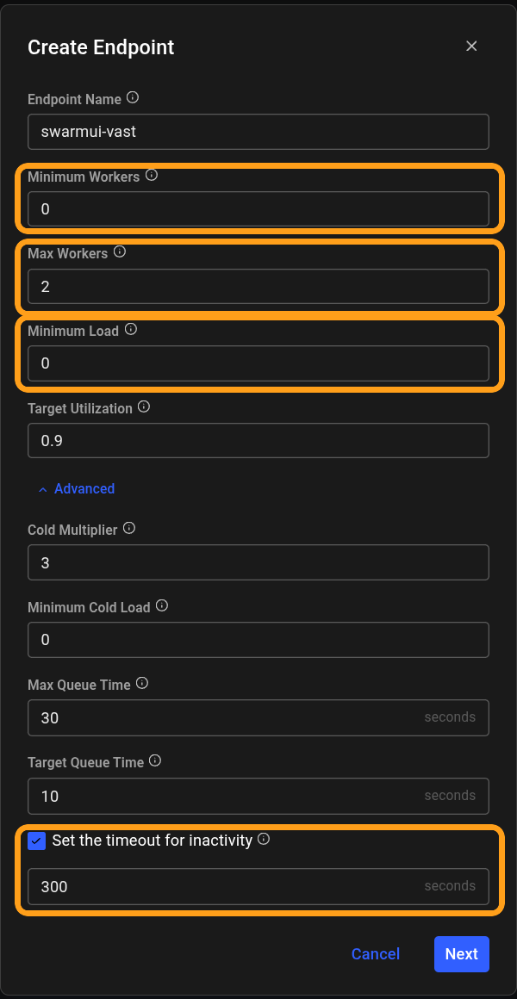
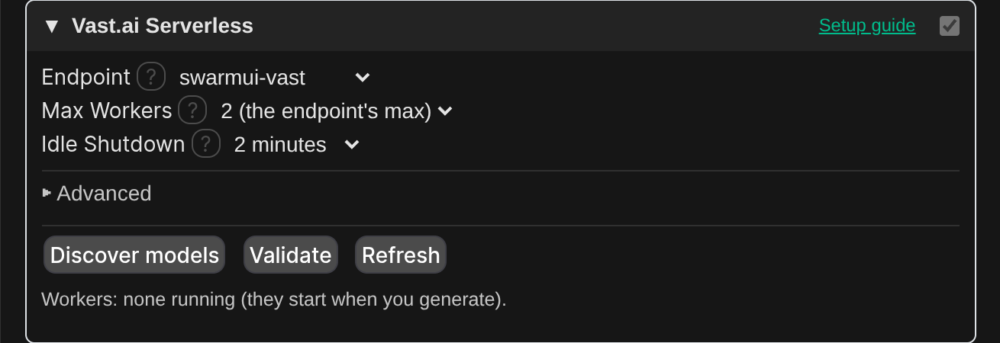

# Vast.ai Serverless setup

This guide takes you from no Vast.ai account to generating images in SwarmUI on Vast.ai's serverless GPUs. Follow it top to bottom.

**How it works:** a Vast.ai **serverless endpoint** runs the Hartsy SwarmUI worker on GPUs from Vast's marketplace. When you generate in SwarmUI, Cloud Backends opens a session on a worker, sends the generation to it, and lets the session expire once you stop generating, so Vast scales the worker down. You pay per second only while a worker runs.

**The one big difference from RunPod:** Vast.ai serverless workers cannot attach a disk, so **your model has to be built into the worker image**. You can use a ready-made image with a model already in it, or build your own. If you want to switch between many models or LoRAs freely, [RunPod Serverless](runpod-serverless.md) (models on a network volume) is a better fit.

> Tip: every screenshot is full resolution. Click one to open it full size and zoom in.

## What you need

- SwarmUI with the Cloud Backends extension installed. See [Installation](../../README.md#installation).
- At least **$5 of Vast.ai credit**. Vast won't let you create a serverless endpoint with less.
- For your own model: [Docker](https://docs.docker.com/get-docker/) and a [Docker Hub](https://hub.docker.com/) account. Not needed if a ready-made image has the model you want.

## Step 1: Create a Vast.ai account and add credit

1. Go to [cloud.vast.ai](https://cloud.vast.ai/) and sign up.
2. Open **Billing** in the left menu and press **Add Credit**.

   

3. Pick an amount ($10 is a good start; at least $5 is required for serverless), pick a payment method, and press **Add credit**.

   

Also on the Billing page: turn on **Auto Top-Up** if you don't want your balance to run out. When it reaches zero, Vast stops your machines, and if it stays negative it eventually deletes your stored data.

## Step 2: Create a Vast.ai API key

1. Open **Keys** in the left menu, then the **API Keys** tab, and press **+ New**.

   

2. Name it (for example `SwarmUI`), keep the default permissions, and press **Save**.

   

3. Copy the key that's shown. Keep it safe: anyone who has it can spend your credit.

## Step 3: Put the key into SwarmUI

1. In SwarmUI, open **User ▸ User Info** and scroll to **API Keys**.

   

2. Paste the key into the **Vast.ai** row and press **Save**.

   

Keys are per user: on a server with user accounts, each user saves their own key and is billed on their own Vast.ai account.

## Step 4: Choose the worker image

**Ready-made images** (your model already inside):

| Image | Model | Notes |
|---|---|---|
| `kalebbroo/swarmui-worker-vast:1.0.0-hartsyinference-krea2-turbo` | Krea 2 Turbo (fp8) with its text encoder and VAE | Generate with 8 steps, CFG 1, 1024x1024. Needs a 24 GB GPU and a 60 GB container disk. |

**Your own model:** build an image with your model inside and push it to your Docker Hub account. On any computer with Docker:

```bash
git clone https://github.com/HartsyAI/Vast-Worker-SwarmUI
cd Vast-Worker-SwarmUI
docker build --build-arg BACKEND=hartsyinference --build-arg BASE_VERSION=1.0.0 \
  --build-arg BAKE_MODEL_URL=https://example.com/my-model.safetensors \
  --build-arg BAKE_MODEL_SHA256=<the file's sha256> \
  -t <your-dockerhub-user>/swarmui-worker-vast:1.0.0-mymodel .
docker push <your-dockerhub-user>/swarmui-worker-vast:1.0.0-mymodel
```

`BAKE_MODEL_URL` is a direct download link to the model file, and `BAKE_MODEL_SHA256` is its checksum (shown on the file's page on Hugging Face, or from `sha256sum` on the file). To bake several files, such as a model with its own text encoder and VAE, see the [worker's README](https://github.com/HartsyAI/Vast-Worker-SwarmUI#images).

## Step 5: Create a template

The template tells Vast which image to run and how.

1. Open **Templates** in the left menu and press **New**.
2. Fill in the top of the form:

   | Setting | Value |
   |---|---|
   | Template Name | Anything, for example `SwarmUI Worker (Krea 2 Turbo)` |
   | Image Path:Tag | Your image from Step 4 |
   | Docker Options | `-p 7801:7801 -p 8000:8000 -e WORKER_PORT=8000` (the Ports list fills in by itself) |

   

3. Scroll down to **Select Launch Mode** and choose **Docker ENTRYPOINT**. The other modes replace the worker's own startup and it never starts.

   

4. Scroll down to **Disk Space** and set **Container disk size** well above the image's size: `60` GB for the Krea 2 Turbo image, or about 3 times your model's size for your own. Vast's default of 8 GB is far too small, and a worker with too small a disk fails without saying why.
5. Press **Create**.

   

## Step 6: Create the serverless endpoint

1. Open **Serverless** in the left menu and press **Get Started** (or **New** if you already have endpoints). In the dialog, choose **Advanced setup**.
2. Set:

   | Setting | Value | Why |
   |---|---|---|
   | Endpoint Name | For example `swarmui-vast`. You'll enter this name in SwarmUI. | |
   | Minimum Workers | `0` | Anything above 0 keeps that many workers loaded and stopped, which bills for their storage. |
   | Max Workers | The most workers you want running at once, for example `2`. At least the **MaxWorkers** on the SwarmUI card. | |
   | Minimum Load | `0` | Anything above 0 keeps a worker running all the time, so the endpoint never scales to zero. Vast's default is 1. |
   | Target Utilization | `0.9` (the default) | |
   | Advanced ▸ Set the timeout for inactivity | On, `300` seconds | Lets the endpoint scale to zero after this many idle seconds. |

   

3. Press **Next**.

## Step 7: Add a workergroup

A workergroup tells the endpoint which template to run, and on which GPUs.

1. Add a workergroup to the endpoint and choose your template from Step 5.
2. Set the GPU filter to **16 GB of VRAM or more** (24 GB for the Krea 2 Turbo image). For the **HartsyInference** images (all the ready-made ones), also require **CUDA 13.0 or newer**: its GPU kernels need a CUDA 13 driver.
3. Create it.

To change the template later, edit it through **Serverless ▸ (your endpoint) ▸ Edit workergroup**. Saving a template from the **Templates** page makes a new copy, which the workergroup doesn't use.

## Step 8: Add the Cloud Backends card in SwarmUI

1. In SwarmUI, open **Server ▸ Backends**, turn on **Show Advanced**, and press **Cloud Backends**. (If you already have a Cloud Backends card, press **✎** on it instead.)

   

2. Open the **Vast.ai Serverless** section and set:

   | Setting | Value |
   |---|---|
   | Enabled | On |
   | EndpointId | The endpoint's **name** from Step 6 (not a number) |
   | MaxWorkers | How many workers SwarmUI may run at once. At most the endpoint's Max Workers. |
   | IdleSeconds | How long a worker waits with nothing to do before it's let go. `120` is a good default. Vast.ai workers are always kept at least 60 seconds. |

3. Press **Save** at the top of the card.



## Step 9: Validate

Press **Validate** in the Vast.ai Serverless section. It checks your endpoint's settings, and warns about the ones that would keep workers running or billing, such as Minimum Load above 0 or no inactivity timeout. Validate is free.

## Step 10: Generate

SwarmUI only lets you pick models it knows about. If the model isn't in your local model list, press **Discover models** once: it starts a worker (billed until it goes idle), reads its model list, and adds it to yours. Then pick the model and generate.

- **The first generation waits for a worker to start.** The first time a machine runs your image it has to download it, which can take several minutes for a large image. Later starts are faster.
- **The Workers line** in the section shows each running worker, with a **Stop** button.
- **After IdleSeconds with no generation, the worker is let go**, and Vast scales it down after the inactivity timeout.

## What it costs

| What | When you pay |
|---|---|
| Serverless workers | Per second, while a worker runs, at the machine's marketplace price. |
| Stopped workers | A little for their disk, if Minimum Workers is above 0. Keep it at 0. |
| The endpoint itself | Nothing. |

## If something goes wrong

| Problem | What to do |
|---|---|
| "Serverless requires a credit balance of at least $5" | Add credit (Step 1). |
| Validate says the API key was rejected | Check the key under **User ▸ User Info ▸ API Keys**, or create a new one. |
| "No Vast.ai worker became available" | No machine matched your workergroup in time. Loosen the GPU filter, or raise **StartupTimeoutSec** on the card while a new image downloads. |
| Workers start and fail without a clear error | Raise the template's container disk size (Step 5), and check the launch mode is Docker ENTRYPOINT. |
| Workers keep running after you stop | Check **Minimum Load** is `0` and the inactivity timeout is on (Step 6). |

More fixes are in the [README's troubleshooting section](../../README.md#troubleshooting).
